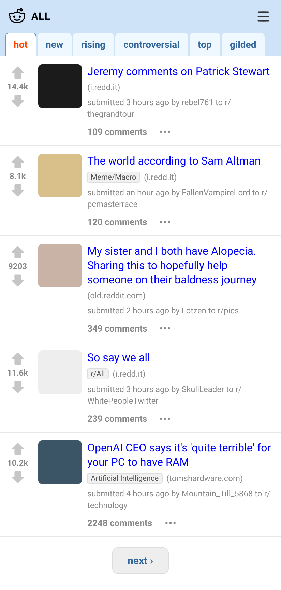
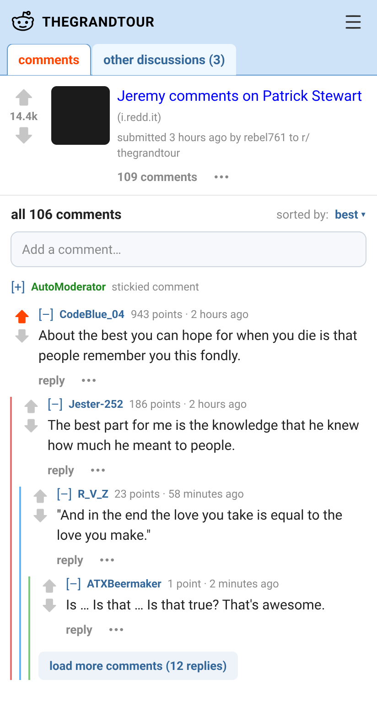
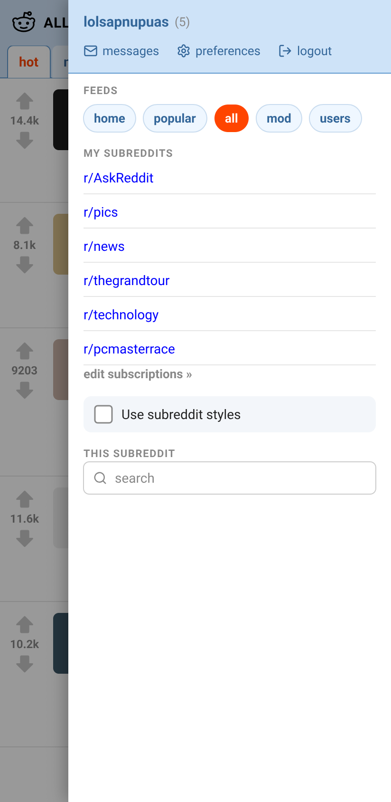

# Mobile Layout for Old Reddit

A Firefox and Chrome extension that makes old Reddit usable on a phone: on old.reddit.com, and on www.reddit.com
when your account uses the old design (the new design is left alone). It only activates on phone-sized
screens, so desktop old Reddit is unchanged.

https://addons.mozilla.org/en-US/firefox/addon/mobile-layout-for-old-reddit/

| Front page | Comment thread | ☰ drawer |
| :---: | :---: | :---: |
|  |  |  |

## What it does

- Lays the page out at the phone's width. No sideways scrolling; titles and comments wrap.
- Sticky top bar: "reddit" (home), the page name (e.g. r/all) and ☰.
- ☰ drawer: Home / Popular / All buttons, account links, other feeds, your subscriptions,
  the "Use subreddit styles" switch, and the subreddit's sidebar.
- Sort tabs scroll sideways under the bar. The "GET NEW REDDIT" button and the email-verification banner are hidden.
- Posts: vote column, 64px thumbnail, full wrapped title. Only "N comments" shows; the rest is behind "⋯".
- Comments: arrows in their own column, ~16px per reply level with a coloured line per depth.
  Tap a line to collapse that whole thread. Only "reply" shows; the rest is behind "⋯".
- The empty reply box at the top of threads becomes an "Add a comment…" button; AutoModerator's pinned comment starts collapsed.
- Subreddit custom styles are off by default.

## Layout

```
extension/        manifest.json, mobile.css, mobile.js, icons/ (the extension itself)
build.py          packages extension/ into dist/: the Firefox .xpi, a Chrome .zip (Manifest V3), and dist/chrome/ unpacked
store/            listing.md (AMO listing text), icon.svg + render_icons.py (icon source)
                  chrome/: Chrome Web Store screenshots and promo tiles (python store/render_chrome_images.py)
design/           Pencil mockups (listing, thread, drawer)
test/             fixture pages copying old Reddit's markup, plus the tests
LICENSE           MIT
```

Tests:

- `python test/make_fixtures.py && python test/run.py` injects the script into the fixtures at 412px (screenshots land in `test/shots/`).
- `python test/e2e.py` loads `extension/` into Firefox as a temporary add-on and serves the fixtures as
  old.reddit.com / www.reddit.com, so the content script runs exactly as installed.
- `python build.py && python test/e2e_chrome.py` does the same in Chromium with the Chrome build (`dist/chrome/`).
  Needs `python -m playwright install chromium` once.

## Trying it in desktop Firefox

1. Open `about:debugging#/runtime/this-firefox` → **Load Temporary Add-on…** → pick `extension/manifest.json`.
   Click **Reload** there after editing, then open a **new** tab (old tabs keep the previous build).
2. Open old.reddit.com, press **Ctrl+Shift+M** (Responsive Design Mode) and choose a phone preset.

`document.documentElement.dataset.ormVersion` in the console shows which build is running.

## Chrome

`extension/manifest.json` stays Manifest V2 for Firefox; `build.py` writes the Chrome copy with `manifest_version: 3`
and without the Firefox-only keys. The script and CSS are shared (`mobile.js` uses `browser` or `chrome`, whichever exists).

To try it: `python build.py`, open `chrome://extensions`, turn on **Developer mode** → **Load unpacked** → pick `dist/chrome/`.
Rebuild and click the reload icon on the extension after editing. Use DevTools' device toolbar (**Ctrl+Shift+M**) for a phone width.

Updates: bump `version` in `extension/manifest.json`, rebuild, then **Upload New Version**.

To install your own signed copy before the listing is approved:
`npx web-ext sign --channel=unlisted --source-dir extension --api-key <key> --api-secret <secret>`,
then in Firefox for Android: Settings → About Firefox, tap the logo 5 times, then Settings → "Install extension from file".
